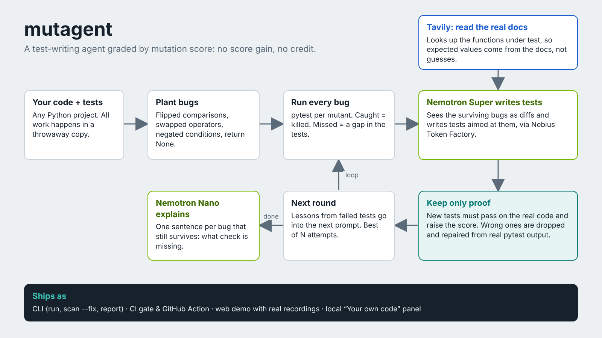

# mutagent

> A test-writing agent that proves its tests are good. It is graded by **mutation score**, not by how many tests it writes.

Built for the **Nebius x NVIDIA Global AI Hackathon** (track: *Coding and Agentic Engineering*), using NVIDIA Nemotron models served through **Nebius Token Factory**.

License: MIT (see `LICENSE`).



**Live demo:** https://mutagent.onrender.com (free hosting: after 15 idle minutes the first visit takes about a minute to wake up).

**Video (3 min):** https://www.youtube.com/watch?v=qPCeRj2NW-U

## The problem

LLM-generated tests often pass without testing anything. Coverage and "number of tests" are easy to game. Mutation testing asks the real question: if I plant a small bug in the code, does a test fail?

Line coverage in particular says little about that. It counts the lines the tests *run*, not the bugs they would *notice*. mutagent measures both (coverage with coverage.py, before and after the agent) so the gap is visible. These are the tests that ship with the libraries I use in the demo, measured with `mutagent score`:

| Module | Line coverage | Planted bugs caught |
|---|---|---|
| cachetools `func.py` | 100.0% | 89.7% (52 of 58) |
| inflection | 98.8% | 90.8% (119 of 131) |
| python-slugify `slugify.py` | 75.6% | 55.4% (92 of 166) |
| Toy pricing module | 64.7% | 34.1% (14 of 41) |

Even with 100% line coverage, 6 of 58 planted bugs slipped through. The page and the Markdown report show coverage next to the score, and `scan` has a coverage column. Only line coverage is measured, not branches.

## How it works

```
 module + existing tests
          |
          v
  generate mutants (small planted bugs)          score = killed / (killed + survived) x 100
          |
          v
  run the suite against every mutant  ------>  survivors = bugs no test detects
          ^                                              |
          |                                              v
  accept only if the new tests                  STRONG Nemotron model writes tests aimed
  (1) pass on the ORIGINAL code and             at the surviving mutants (shown as diffs)
  (2) strictly raise the score  <---------------------- /
```

- **Planted bugs:** flipped comparisons (`<`/`<=`, `==`/`!=`, `in`/`not in`, `is`/`is not`), swapped arithmetic (also `+=`), `and`/`or` swaps, removed `not`, negated `if` conditions, `return x` replaced by `return None`, and bumped integer / flipped boolean constants.
- **Two model tiers on purpose.** `STRONG` (a larger Nemotron model) writes and repairs tests. `FAST` (a small Nemotron model) writes a one-line explanation of every bug that is still alive at the end (`--explain`), and can optionally set aside survivors that look unkillable (`--triage`). Triage is off by default: in my runs the small model twice called a catchable bug unkillable.
- **Keeps the good tests.** When some new tests fail on the original code, only those are dropped; the STRONG model then sees the real pytest output once and fixes the wrong expectations, and the same output is passed into the next round so the mistake is not repeated.
- **A comparison baseline.** `mutagent baseline` runs the same loop with the same model and the same acceptance rule, but never shows the model which bugs survive. The difference between the two scores is what the survivor feedback adds.
- **Hard token budget** per run (`NEBIUS_TOKEN_BUDGET`), so a public demo cannot drain credits.
- **Honest acceptance rule.** Tests that fail on the original code, or that do not improve the score, are rolled back. The failure output is fed into the next prompt.

## Where NVIDIA and Nebius are used


| Component | What it does |
|---|---|
| NVIDIA Nemotron (STRONG tier) | `nvidia/nemotron-3-super-120b-a12b`. Writes tests targeting surviving mutants and repairs wrong expectations from real pytest output. |
| NVIDIA Nemotron (FAST tier) | `nvidia/NVIDIA-Nemotron-3-Nano-30B-A3B`. Explains each surviving bug in one line (`--explain`, used in the recordings); optional triage of likely-equivalent mutants (`--triage`, not used below). |
| Nebius Token Factory | All inference calls (`src/mutagent/llm.py`). |
| Web demo hosting | The demo page runs on Render's free tier (Docker). Only the model calls go to Nebius, which the hackathon FAQ allows. |

## Quick start

```bash
python -m venv .venv && source .venv/bin/activate
pip install -e ".[dev]"
cp .env.example .env        # fill in the key, base URL and model IDs from the Token Factory docs

# 1. no model needed: score the demo project's deliberately weak tests
mutagent score --project examples/demo_project --target pricing.py

# 2. run the agent (uses Token Factory, up to --rounds rounds); --explain lets the small FAST model explain the bugs that survive
mutagent run --project examples/demo_project --target pricing.py --rounds 6 --explain

# 2b. model runs vary a lot; run the whole loop up to 3 times and keep the best (3x the tokens)
mutagent run --project examples/demo_project --target pricing.py --explain --attempts 3

# 2c. afterwards keep only the new tests that catch something the others miss (test runs only, no tokens)
mutagent run --project examples/demo_project --target pricing.py --explain --minimize

# 3. the comparison baseline: same loop and model, no bug feedback
mutagent baseline --project examples/demo_project --target pricing.py
```

**Trimming (`--minimize`).** The agent keeps a whole round of tests whenever the score rises, so the final file often holds tests that catch nothing the others don't already catch. `--minimize` runs the new tests alone against every planted bug only they catch, keeps the smallest set that still catches all of them, and checks that the trimmed file passes and reaches the same score; otherwise it keeps the full file. The report and the page say how many tests were dropped. The web demo always trims.

Other commands: `mutagent mutants ...` lists the mutants for a module without running anything. `python -m pytest` runs this repo's own tests, which use a fake model and need no API key.

### Real projects

```bash
# only run the test file(s) that cover the module (much faster, avoids unrelated test dependencies)
mutagent score --project path/to/lib --target src/pkg/mod.py --tests tests/test_mod.py
```

- `src/` and flat layouts both work: the mutated copy is put first on `PYTHONPATH`, so an installed copy of the library is never tested by mistake.
- Libraries that generate files at build time (for example a `_version.py` from setuptools-scm or hatch-vcs) need a placeholder in the checkout you point `--project` at.
- Cost grows with `mutants x test-run time`; every round re-scores all mutants.

### Targets measured so far

Baseline mutation score and line coverage of each project's *own* tests, before the agent does anything (measured with the current 12 kinds of planted bugs, in a cloud Linux container, without `--sandbox`; the time includes the coverage run and varies by machine). These are not agent results.

| Target (MIT-licensed) | Mutants | Baseline score | Line coverage | Scoring time |
|---|---|---|---|---|
| `examples/demo_project/pricing.py` (toy) | 41 | 34.1% | 64.7% | ~20 s |
| cachetools `func.py` | 58 | 89.7% | 100.0% | ~28 s |
| python-slugify `slugify.py` (two of its test files) | 166 | 55.4% | 75.6% | ~100 s |
| inflection `__init__.py` | 131 | 90.8% | 98.8% | ~95 s |
| humanize `filesize.py` | 44 | 97.7% | 100.0% | ~24 s |
| humanize `lists.py` | 21 | 90.5% | 100.0% | ~12 s |
| humanize `time.py` | 444 | 91.0% | 100.0% | ~11 min |
| cachetools `keys.py` (with its own `test_keys.py`, not shipped) | 23 | 91.3% | 100.0% | ~11 s |

Five of these modules have 100% line coverage, and in every one of them some planted bugs still slip through.

Unmodified copies of cachetools, inflection and python-slugify (all MIT) are vendored in `examples/` so the demo runs out of the box; each folder has a `VENDORED.md` with the source and license. The humanize rows were measured on a separate checkout and are not shipped.

```bash
mutagent score --project examples/cachetools_demo --target src/cachetools/func.py --tests tests/test_func.py
mutagent score --project examples/inflection_demo --target inflection/__init__.py --tests test_inflection.py
mutagent score --project examples/slugify_demo --target slugify/slugify.py --tests tests/test_legacy.py tests/test_modern_word_boundary.py
```

The generated tests are written to `tests/test_mutagent_generated.py` inside the target project, and a JSON report (score per round, tokens used) to `mutagent_report.json`.

## Web demo

```bash
pip install -e ".[web]"
mutagent serve            # http://127.0.0.1:8000
```

The page shows every planted bug as a circle (hollow = slipped through, filled = caught by a test), the score after each round, and the tests the agent kept.

- **Recorded run:** plays back a real run from `replays/<preset>.json`, next to the no-feedback comparison from `replays/<preset>-baseline.json` when it exists. Record them with `python scripts/record.py` (see `replays/README.md`). Recordings come from real runs only.
- **Live run:** starts a capped run against the model. It switches on only when the `NEBIUS_*` values from `.env.example` are set; otherwise the page offers recordings only.
- **Presets only:** visitors pick one of the fixed libraries in `src/mutagent/presets.py`. They never upload code or write prompts. Libraries that take about a minute per scoring pass are recording-only.
- **Limits (see `.env.example`):** one live run at a time, a token budget per run, a cap on live runs per day.

Container image (deployed on Render; the Dockerfile listens on `$PORT`, default 8000): `docker build -t mutagent .`, then `docker run -p 8000:8000 --env-file .env mutagent`. It runs as an unprivileged user with `MUTAGENT_LIMITS=1`.

## Use it in CI

`mutagent score` and `mutagent scan` need no API key, so they can gate a pull request: the job fails when the tests miss too many planted bugs. The repository is also a GitHub Action:

```yaml
# .github/workflows/mutation-gate.yml in your project
name: mutation-gate
on: [pull_request]
jobs:
  gate:
    runs-on: ubuntu-24.04
    steps:
      - uses: actions/checkout@v5
        with:
          fetch-depth: 0                   # needed for diff-base
      - uses: Sarmax04/mutagent@v1
        with:
          targets: src/yourpkg/module.py   # leave out to score every module
          tests: tests/test_module.py      # leave out to run everything pytest finds
          min-score: "85"
          install: pip install -e .        # your project's own dependencies
          diff-base: origin/${{ github.base_ref }}   # optional: only the lines this PR changed
          comment: "true"                  # optional: post the table on the PR
    permissions:
      contents: read
      pull-requests: write                 # only for comment: "true"
```

It writes the score table to the job summary and exposes the lowest score as the `lowest-score` output. With `comment: "true"` it also posts the table as a pull-request comment and updates that same comment on every push.

**Only the changed lines.** Scoring whole modules on every pull request is slow. With `diff-base` (or `--diff REF` on `score`, `scan` and `run`) mutagent plants bugs only on the lines that changed since the merge base with that ref, uncommitted edits included, and `scan --discover --diff origin/main` looks only at the modules that changed. A module git does not track yet counts as entirely new. Only the first line of a statement counts, so a change in the continuation line of a long expression does not select that expression's bugs.

**Badge.** `mutagent score ... --badge mutation.svg`, `mutagent scan ... --badge mutation.svg` (lowest module) or `mutagent badge --report mutagent_report.json` write a small SVG badge for a README. Without the Action: `pip install "git+https://github.com/Sarmax04/mutagent"` and `mutagent scan --project . --discover --min-score 85` (exit code 4 when a module is below the line).

To let the agent strengthen the tests, run `mutagent run ... --min-score 85 --minimize` with `NEBIUS_API_KEY` set as a secret, then turn the saved JSON into a readable report with `mutagent report mutagent_report.json --out report.md`. The web demo also has a "Download test file" button.

### Ground the tests in the real documentation (Tavily)

```
mutagent run --project examples/inflection_demo --target inflection/__init__.py --tests test_inflection.py --explain --docs
```

The most common reason the agent throws a test away is a wrong expectation: the model guesses what a function returns instead of knowing it. With `--docs`, before each round the agent finds the functions the surviving bugs live in, looks up their documentation with the [Tavily Search API](https://docs.tavily.com) and gives Nemotron a short digest next to the source code (the source code wins where they disagree). Each function is looked up once per run, at most two new lookups per round (1 Tavily credit each). The sources it read are listed in the report and on the demo page. Needs `TAVILY_API_KEY` in `.env`; `--docs-name` overrides the name searched for. Lookups are best effort: if Tavily is unreachable the run continues without them.

### Try it on your own project (web)

```
mutagent serve --local
```

Open http://127.0.0.1:8000 and choose "Your own code". Type the folder of a Python project, press "Find modules", pick a module and the test files that count, and start the run. The page shows the planted bugs, the score after every round, the bugs that got away and the new tests, with buttons to copy or download them. This panel needs your `.env` with a Nebius key, only works on `127.0.0.1`, and never writes into your project. It is not part of the hosted demo.

### Check a whole project

```
mutagent scan --project . --discover --tests tests/test_app.py
mutagent scan --project . --targets src/app/a.py src/app/b.py --min-score 85
mutagent scan --project . --discover --min-score 85 --fix
```

`scan` scores every module (no API key needed) and prints a table with the mutation score and the line coverage of each module. With `--min-score` it exits with code 4 if any module is below the line. With `--fix` the agent then works on each weak module. When it improves the score it writes `tests/test_mutagent_<module>.py`, and it always saves a JSON report per module in `mutagent_reports/`.

## Results

Real runs against Nebius Token Factory with NVIDIA Nemotron models, recorded with `python scripts/record.py --docs --attempts 3 --sandbox`: all 12 kinds of planted bugs, up to 6 rounds, stop after 3 rounds without progress, the best of 3 attempts, documentation lookups with Tavily (the toy module has no published docs, so it gets none), every test run in Nebius Token Factory Sandboxes, and the final tests trimmed with `--minimize`. Each row compares the survivor-guided agent with the baseline: the same loop, model, attempts, docs, repair steps and acceptance rule, but the model is never told which bugs survive. These recordings are the ones the web demo plays.

| Target | Planted bugs | Score before | No bug feedback (same model) | Agent (guided) | Line coverage (agent) | Tests kept (agent) | Tokens: agent / baseline |
|---|---|---|---|---|---|---|---|
| `examples/demo_project/pricing.py` | 41 | 34.1% | 95.1% | **97.6%** | 64.7% → 100% | 7 of 10 | 112,648 / 84,802 |
| cachetools `func.py` | 58 | 89.7% | 89.7% | **98.3%** | 100% → 100% | 5 of 19 | 192,469 / 149,539 |
| python-slugify `slugify.py` | 166 | 55.4% | 86.1% | **89.8%** | 75.6% → 95.6% | 15 of 40 | 479,203 / 363,628 |
| inflection `__init__.py` | 131 | 90.8% | 90.8% | **95.4%** | 98.8% → 98.8% | 2 of 11 | 349,035 / 323,284 |

What this shows, honestly:

- **The loop works.** Every agent run raised the score, and every kept test passes on the real code. On cachetools the baseline could not raise the score in any of its 3 attempts; the agent did in all 3, because the surviving bugs pointed it at default arguments the shipped tests never check.
- **This time survivor feedback won every comparison**, by 2.4 to 8.6 points. Earlier recordings (one attempt each, 7 kinds of planted bugs, no docs) were mixed: over 8 head-to-head runs the agent was ahead 3 times, tied 3 times and behind 2 times. Single runs swing by several points, and best-of-3 smooths that out, so I read it as a real but modest edge, not a guarantee.
- **It costs more tokens.** The agent used more tokens in all 4 comparisons (1.13M vs 0.92M, about 23% more), because each prompt carries the surviving bugs as diffs. The whole recording, agent and baseline, used about 2.05M tokens.
- **Coverage hides the gap.** cachetools and inflection were at 100% and 98.8% line coverage before and after; only the mutation score moved.
- **Trimming matters.** The agent keeps whole rounds of tests while the score rises; `--minimize` then removed between 30% and 82% of them without losing a single caught bug.
- **Nemotron's raw output needed a lot of guarding.** Across the 8 recorded runs (24 attempts), 16 replies were not valid Python and 6 rounds produced tests that failed on the real code; the one-time repair from real pytest output rescued failing tests 58 times. Only 36 of 109 rounds raised the score; the rest changed nothing.
- The bugs that stay alive are a mix of hard ones and equivalent mutants (changes no test can detect, such as `<= 5` vs `< 5` where both branches give the same price). The small model's explanation of each is in the report and on the demo page; I did not verify every one by hand.

### More modules (`mutagent scan --fix`)

The same agent, no per-module tuning, on modules the shipped tests barely touch (single attempts, measured with the earlier 7 kinds of planted bugs):

| Module | Mutants | Before | After | Tokens |
|---|---|---|---|---|
| python-slugify `special.py` | 9 | 77.8% | 100% | 10,134 |
| cachetools `keys.py` (tests: `test_func.py` only) | 19 | 36.8% | 100% | 13,539 |
| cachetools `_cached.py` (tests: `test_func.py` only) | 80 | 23.8% | 96.2% | 123,448 |

Failures I hit while getting the first runs working, and what changed:

- The reasoning model spent its whole reply budget thinking and returned no code. Fixes: a higher reply limit (`NEBIUS_MAX_TOKENS`), a stricter prompt, and an option to switch thinking off (`NEBIUS_EXTRA_BODY`).
- One wrong expectation made the agent reject a whole file of otherwise good tests. It now removes only the failing test functions and re-checks the rest.
- The model often got expectations wrong in the same way round after round. The real pytest output now goes into a one-time repair and into the next round's prompt; on `_cached.py` that took the agent from 56% to 96%.
- The model sometimes returned a test file without closing the code block, or without any code block. Both are now accepted when they contain tests.
- Dropping failing tests broke on parametrized tests, test classes, unittest-style classes and setup errors. All are handled now, and every time nothing can be dropped the log says why.
- The small model's triage once hid a bug the agent could actually catch, so triage is off by default.
- On Windows the generated tests were saved in a legacy encoding and crashed on a non-ASCII character. All files are now read and written as UTF-8.

## Safety

The agent executes model-written test code with pytest, so treat it as untrusted code.

- Each test run has a timeout.
- In the web demo, every model-written test file is screened first (`src/mutagent/safety.py`) and is rejected before running if it imports modules such as `os`, `subprocess`, `socket` or `io`, or calls `exec`, `open` and similar. This is a denylist and **not a sandbox**; a determined attacker could get around it.
- `MUTAGENT_LIMITS=1` (Linux) starts each pytest process under CPU, memory and file-size limits.
- **Real isolation:** with `--sandbox` every pytest run happens in Nebius Token Factory Sandboxes instead of on your machine (see below). Without it, isolation has to come from where you run mutagent: a container, as an unprivileged user, without secrets and ideally without network access. Don't run it without `--sandbox` on a machine with data you care about.

## Running the tests in Nebius Token Factory Sandboxes

Token Factory Sandboxes (beta) run untrusted code in isolated, on-demand environments. With `--sandbox`, mutagent runs **every** pytest invocation there: the project's own tests, the model's new tests and one run per planted bug. Model-written code never executes on your machine, and the planted bugs are tested in parallel (16 at a time by default, at most 40; the beta allows 50 concurrent operations).

```bash
pip install -e ".[sandbox]"            # installs contree-sdk
# in .env: NEBIUS_API_KEY (already there) and NEBIUS_PROJECT_ID (from tokenfactory.nebius.com/project/api-keys)
mutagent sandbox-check                 # tiny end-to-end test, no model calls
mutagent score --project examples/demo_project --target pricing.py --sandbox
mutagent run   --project examples/demo_project --target pricing.py --sandbox --explain
mutagent scan  --project . --discover --sandbox --min-score 85 --sandbox-packages requests
```

How it works (`src/mutagent/sandbox.py`):

1. Once per run, one image is prepared: `python:3.12-slim`, `pip install pytest coverage` (plus `--sandbox-packages`), and a snapshot of your project in `/work`.
2. Every test run starts from that image and uploads only the files that differ from the snapshot (the mutated module, the generated tests), then runs pytest under `timeout`.
3. If the sandbox itself fails (network, quota, a failed operation), mutagent stops with an error. An infrastructure failure is never counted as a caught bug, so a broken sandbox cannot inflate a score.

The web server can do the same: `MUTAGENT_SANDBOX=1` makes every live run use Sandboxes, and the server refuses to run anything if Sandboxes are not usable. In `serve --local` the "Your own code" panel has a checkbox for it. `scripts/record.py --sandbox` records the demo runs this way.

The sandbox runs Python 3.12 (change it with `MUTAGENT_SANDBOX_IMAGE`), so a module that needs another Python version or system libraries needs a different image. Everything the tests import has to be installable with pip (`--sandbox-packages`). The automated tests of this repository use a local stand-in for the Sandboxes SDK that executes the same shell commands; the real service is exercised by `mutagent sandbox-check`.

## Limitations

- The built-in mutation engine has 12 kinds of planted bugs: flipped comparisons, swapped arithmetic, `and`/`or` swaps, a removed `not`, reversed `if` conditions (also comprehension filters), `return x` -> `return None`, changed integer and boolean constants, and inside functions a removed call statement, a removed `raise`, swapped `break`/`continue`, a dropped minus sign and an assigned value replaced by `None`. It does not change strings, slices or default arguments. It is isolated in `mutation.py` and can be replaced by mutmut or Stryker.
- Some surviving mutants are *equivalent* (they change no behaviour), so 100% is not always reachable.
- Coverage is line coverage of the one module, measured with coverage.py. If coverage.py fails, the figure is left out and the run continues.
- Module paths follow a flat or `src/` layout; the project's own test dependencies must be installed in the environment that runs `mutagent`.

## Feedback

Notes on Nebius Token Factory, AI Cloud and the NVIDIA tools used are collected in `FEEDBACK.md`.
